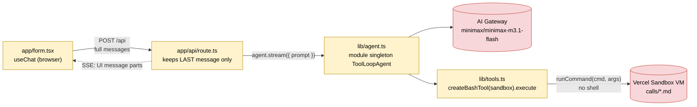
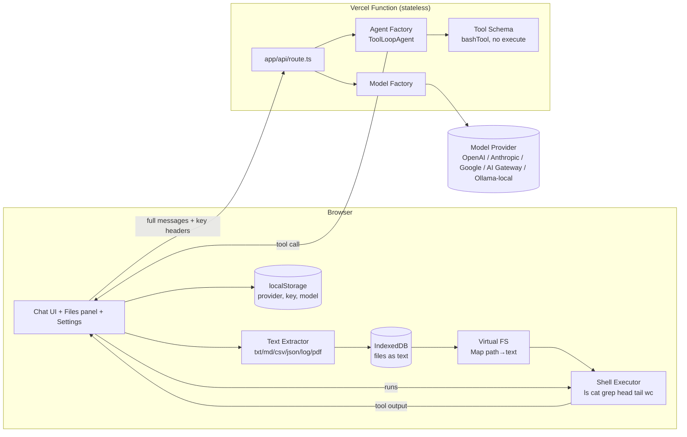
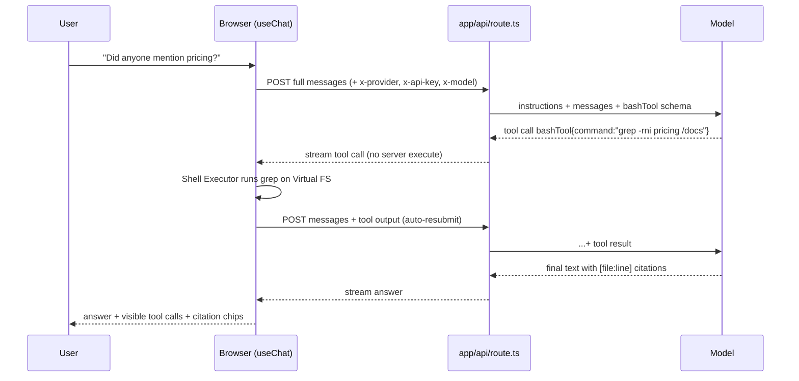

# High-Level Design — "Ask Your Docs"

> Living document. Updated after every piece of the migration (see `prd.md` §6).
> Branch: `mvp` · Baseline tag: `course-complete` (`369bb58`)

**Legend:** ✅ built · 🔁 built, will change · 🗑 to be removed · ⬜ planned

---

## 1. Current state (what runs today)

The course app, unchanged. One HTTP request runs the **whole** agent loop on the server; the tool
executes inside a Vercel Sandbox VM.

What the MVP must change (found in P0-02):
1. `app/api/route.ts:11-19` — discards history, sends only the last message as `prompt` → **W4-01**.
2. `lib/agent.ts:11-23` — module-level singleton (one sandbox + one fixed model for all users,
   Node-only `fs`/`path`) → **W4-05, M5-04**.
3. `lib/tools.ts:15-24` — tool `execute` runs on the server → **W4-02, W4-03**.

---

## 2. Target state (MVP)

### 2.1 Sequence: one question

Key shift from today: **each tool round trip is a new HTTP request** (the browser executes the
tool), so the server must receive the full history every time.

### 2.2 Contracts
- **Request** `POST /api`
  - Headers: `x-provider` (`gateway|openai|anthropic|google|ollama`), `x-api-key`, `x-model`
  - Body: `{ messages: UIMessage[] }` — full history, **no file contents**
- **Tool `bashTool`** input `{ command: string }` →
  output `{ stdout: string, stderr: string, exitCode: number, truncated: boolean }`
- **StoredFile** (IndexedDB): `{ id, name, path: "/docs/<name>.txt", mime, sizeBytes, text, pageCount?, addedAt }`
- **Settings** (localStorage): `{ provider, apiKey, modelId }`

---

## 3. Component status

| Component | File | Status | Piece |
|---|---|---|---|
| Chat UI | `app/form.tsx` | 🔁 single-turn, server tool | W4-03, C6-01, C6-02 |
| Page layout | `app/page.tsx` | 🔁 renders `<Form />` only | F2-01 |
| API route | `app/api/route.ts` | 🔁 last message only | W4-01, M5-05 |
| Agent | `lib/agent.ts` | 🔁 module singleton | W4-05, M5-04 |
| Tool | `lib/tools.ts` | 🔁 server `execute` via sandbox | W4-02 |
| Vercel Sandbox | `@vercel/sandbox` | 🗑 | W4-05 |
| Call transcripts | `lib/calls/*.md` | 🔁 move to `samples/` | F2-07 |
| Instructions | `lib/instructions.ts` | ⬜ | W4-04 |
| Model factory | `lib/models.ts` | ⬜ | M5-03 |
| Settings | `lib/settings.ts`, `components/settings-dialog.tsx` | ⬜ | M5-01, M5-02 |
| Files panel | `components/files-panel.tsx` | ⬜ | F2-01, F2-05 |
| Text extractor | `lib/files/extract.ts` | ⬜ | F2-02, F2-03 |
| File store | `lib/files/store.ts` | ⬜ | F2-04 |
| Virtual FS | `lib/shell/vfs.ts` | ⬜ | T3-01 |
| Shell executor | `lib/shell/executor.ts` (+ tests) | ⬜ | T3-02 – T3-04 |
| Tool-call view | `components/tool-call-view.tsx` | ⬜ | C6-02 |
| Citations | `components/citation.tsx` | ⬜ | C6-03 |
| Compaction | `lib/compact.ts` | ⬜ | C6-06 |

---

## 4. Deployment

| Branch | Vercel environment | URL |
|---|---|---|
| `mvp` | Preview | https://filesystem-agent-git-mvp-kodent-labs.vercel.app (latest commit on `mvp`) |
| `main` | Preview ⚠ | Project's production branch is still set to `master`; until changed, `main` pushes deploy as Preview. Fix before D8-05. |

Auth on Vercel today: AI Gateway and Sandbox both use the auto-injected OIDC token; no project
env vars are set. `.env.local` is for local `pnpm dev` only.

---

## 5. Dependencies

AI SDK packages are pinned to the **`ai-v6` dist-tag line** (`latest` is AI SDK 7 and would not
type-check against `ai@6`). Caret ranges (`^3.0.x`, `^2.0.x`) can't cross a major, so they stay on v6.

| Package | Version | Used by |
|---|---|---|
| `ai` | 6.0.315 (single copy) | agent, route, `createGateway` (re-exported, so no separate `@ai-sdk/gateway`) |
| `@ai-sdk/react` | 3.0.318 | `useChat` in `app/form.tsx` |
| `@ai-sdk/openai` / `anthropic` / `google` | 3.0.131 / 3.0.135 / 3.0.138 | model factory (M5-03) |
| `@ai-sdk/openai-compatible` | 2.0.87 | Ollama, local only (M5-06) |
| `vitest` (dev) | 5.0.5 | executor tests (T3-04) |
| `@vercel/sandbox` | 1.10.2 | 🗑 removed in W4-05 |

Node: `engines.node >=22` → Vercel resolves to 24.x; local dev runs 26.x.

---

## 6. Changelog

| Piece | Change |
|---|---|
| P0-01 | Tagged `course-complete` at `369bb58`; created `mvp` branch; first preview deployed (`be41dde`). |
| P0-02 | Walked the request path `form.tsx → route.ts → agent.ts → tools.ts → Sandbox`; identified the three required changes (§1). |
| P0-03 | Created this HLD and `docs/decisions.md`. |
| P0-04 | Updated deps within range (deduped two `ai` copies → 6.0.315); added v6-line providers + vitest; `engines.node >=22`; `@types/node` 24. Refreshed the expired local OIDC token. Verified: `tsc` passes, `POST /api` answers end-to-end. |
