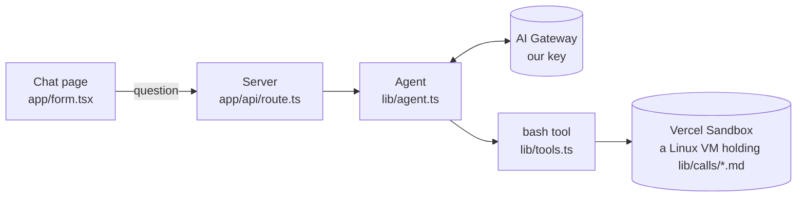
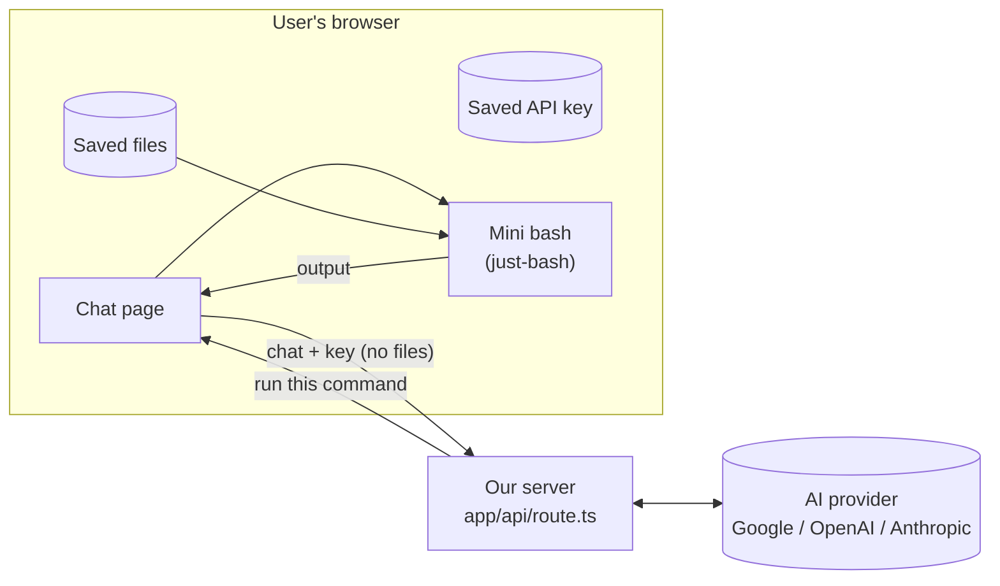
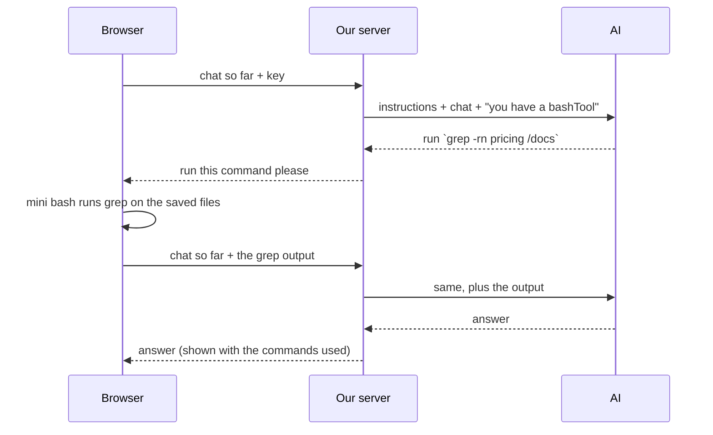

# How "Ask Your Docs" works

> Updated after every step. The plan is in `prd.md`; the reasons behind choices are in
> `docs/decisions.md`.
> Branch `mvp` · Course version saved as tag `course-complete`.

**Status:** ✅ done · 🔁 exists, will change · 🗑 will be removed · ⬜ not built yet

---

## 1. Today: the course app (still running)

- The whole back-and-forth (AI → command → AI) happens **on the server** in one request.
- What has to change:
  1. ~~The server only reads the **last** message, so follow-up questions don't work.~~ Fixed in Step 5.
  2. The agent and sandbox are created **once and shared** by everyone, with one fixed model.
  3. ~~Commands run in a **sandbox on the server**, but the files will be in the browser.~~ Fixed in Steps 6–7 (the sandbox code itself goes in Step 8).

---

## 2. Target: the MVP

### One question, step by step

Each command = one more request from the browser. So the browser must send the **whole chat**
every time, and the server keeps no memory between requests.

---

## 3. Parts

| Part | File | Status | Step |
|---|---|---|---|
| Chat page | `app/form.tsx` | ✅ runs the AI's commands in the browser: `onToolCall` → `runCommand(command, await listFiles())` → `addToolOutput`, resends with `sendAutomaticallyWhen`. Max 10 commands per answer (counter in a `useRef`). Shows `$ command` + output, tool errors in red. 🔁 polish in Step 11 | 5, 7, 11 |
| Page layout | `app/page.tsx` | ✅ files panel on the left, chat on the right | 1 |
| Server route | `app/api/route.ts` | 🔁 `createAgentUIStreamResponse({ agent, uiMessages: messages })`: the whole chat goes to the agent. `onError` logs only `error.message`. Still uses our shared agent and key | 5 ✅, 10 |
| Agent | `lib/agent.ts` | 🔁 uses `INSTRUCTIONS` + `bashTool`; still created once and shared. Unused sandbox code still runs at startup | 8, 10 |
| bash tool | `lib/tools.ts` | ✅ `bashTool`: input `{ command: string }` (one full command line, D7), **no `execute`**, so the agent loop stops and the browser runs it | 6 |
| Sandbox | `@vercel/sandbox` | 🗑 | 8 |
| Course transcripts | `lib/calls/*.md` | 🗑 still used by the server sandbox until Step 8 | 8 |
| Sample files | `public/samples/call-*.md` | ✅ copies of the 3 transcripts with clear names; "Load sample files" button in the panel | 3 |
| Files panel | `components/files-panel.tsx` | ✅ pick or drop files, list name + size, × remove, Clear all, red error messages. Loads saved files on open | 1, 2 |
| Saved files | `lib/files.ts` | ✅ `listFiles` / `addFile` / `removeFile` / `clearFiles` over IndexedDB (`idb-keyval`, database `ask-your-docs`, store `files`, key = file name). Rules: 4 types, 20 files, 1 MB, `notes (2).md` | 2 |
| Mini bash | `lib/shell.ts` (+ `lib/shell.test.ts`) | ✅ `runCommand(command, files) → { stdout, stderr, exitCode, truncated }`. Loads `just-bash` on first use, new `Bash` per command, `cwd /docs`, hardened limits, output cut at 8,000 characters, never throws. Not used by the UI yet | 4, 7 |
| AI instructions | `lib/instructions.ts` | ✅ files are in `/docs`; tool only when needed (no tools for "hi"); one `grep -rni` first, then `sed -n` for lines; answer only from files; "Not found in your documents."; cite `[file:line]` | 6 |
| Settings box | `components/settings-dialog.tsx`, `lib/settings.ts` | ⬜ | 9 |
| Model picker | `lib/models.ts` | ⬜ | 10 |

---

## 4. Packages

| Package | Why |
|---|---|
| `ai` 6.0.315, `@ai-sdk/react` 3.0.318 | agent + chat. We stay on **v6**: add AI SDK packages with `@ai-v6`, not plain `pnpm add` |
| `@ai-sdk/google`, `@ai-sdk/openai`, `@ai-sdk/anthropic` | talk to the user's chosen provider (Step 10) |
| `just-bash` 3.6.0 | the mini bash in the browser (Step 4) |
| `idb-keyval` 6.3.0 | saves files in the browser's IndexedDB (Step 2). Tiny, Apache-2.0; opens the database lazily, so it's safe on the server |
| `vitest` | tests: `pnpm test` runs `vitest run` (Step 4) |
| `@vercel/sandbox`, `@ai-sdk/openai-compatible` | 🗑 removed in Step 8 |

Node: `>=22` in `package.json`. Vercel uses 24, your laptop runs 26.

---

## 5. Where it runs

| Branch | Vercel | URL |
|---|---|---|
| `mvp` | Preview | https://filesystem-agent-git-mvp-kodent-labs.vercel.app |
| `main` | Preview for now | Vercel's production branch is still `master`. Fix it in Step 12. |

---

## 6. Log

| Step | What happened |
|---|---|
| 0 | Tagged `course-complete`, made branch `mvp`, first preview deploy. |
| 0 | Read through the code; found the 3 things to change (§1). Wrote these docs. |
| 0 | Packages updated (one copy of `ai`, v6 providers, vitest, Node `>=22`). Refreshed the expired local OIDC token. |
| 0 | Spike 1: `just-bash` ran `grep -rn hello /docs`, pipes and globs in Chrome. It only downloads on first use, and a fresh copy per command throws away any writes. |
| 0 | Spike 2: a tool with no `execute`; the browser answered it (`onToolCall` → `addToolOutput`) and resent the chat (`sendAutomaticallyWhen`). 2 requests in total; the AI used the browser's answer. |
| 0 | Plan simplified: text files only, files saved in the browser, user's own key (Google / OpenAI / Anthropic). |
| 1 | Files panel added beside the chat. Picking or dropping files reads their text (`file.text()`) into React state as `{ name, size, text }`. Not saved yet, and not connected to the chat. |
| 2 | Files saved in IndexedDB through `lib/files.ts`; the panel re-reads the saved list after every change. Tested in Chrome: survives reload, duplicate → `notes (2).md`, `.pdf` and >1 MB refused, 21st file refused, remove and clear stick after reload. |
| 3 | Transcripts copied to `public/samples/` as `call-1-platform-review.md`, `call-2-follow-up-review.md`, `call-3-commercial-alignment.md`. The button fetches the missing ones, wraps them as `File`s and adds them like a user pick. It hides once all 3 are saved, so no copies. |
| 4 | `lib/shell.ts` added, with 9 vitest tests (`pnpm test`): grep with line numbers, `-i`, pipes, names with spaces, exit codes 0/1/127, no network (`curl` doesn't exist), writes thrown away, 8,000-character cut, no files. |
| 5 | The route sends the whole chat to the agent (`createAgentUIStreamResponse`); the input stays visible. Tested in Chrome: the 2nd request carried `user,assistant,user`, and "how many calls did we have with **them**" was answered as Northstar Commerce (3 calls). Old tool still sends bad commands (D7, 400s from the sandbox) until Step 6. Refreshed the local OIDC token. |
| 5 | Fix: "hi" ran 19 commands and read every file, because the course instructions said to always use `bashTool`. The instructions in `lib/agent.ts` now say: use the tool only when the message needs the files, reply to small talk without tools, and start with one targeted search. Retested: "hi" and "thanks!" use 0 commands. |
| 6–7 | The switch. `bashTool` has no `execute`; the browser runs it over the saved files with `just-bash` and sends the output back. Tested in Chrome with the samples: "hi" → 1 request, 0 commands; "Did anyone mention pricing?" → 2 commands (one `grep -rni -e … /docs`), answer with `[file:line]`; finance follow-up → 1 command; "CEO's favourite colour" → "Not found in your documents."; limit test → 10 commands ran, 11th and 12th refused, stopped. Biggest request 9,800 characters; no request contained a whole file. |
