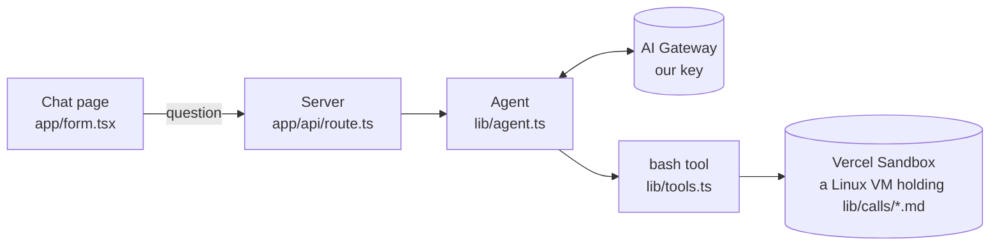
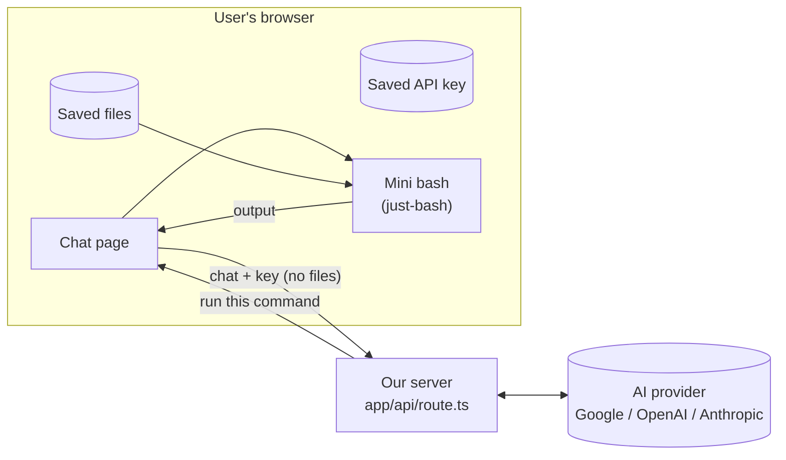
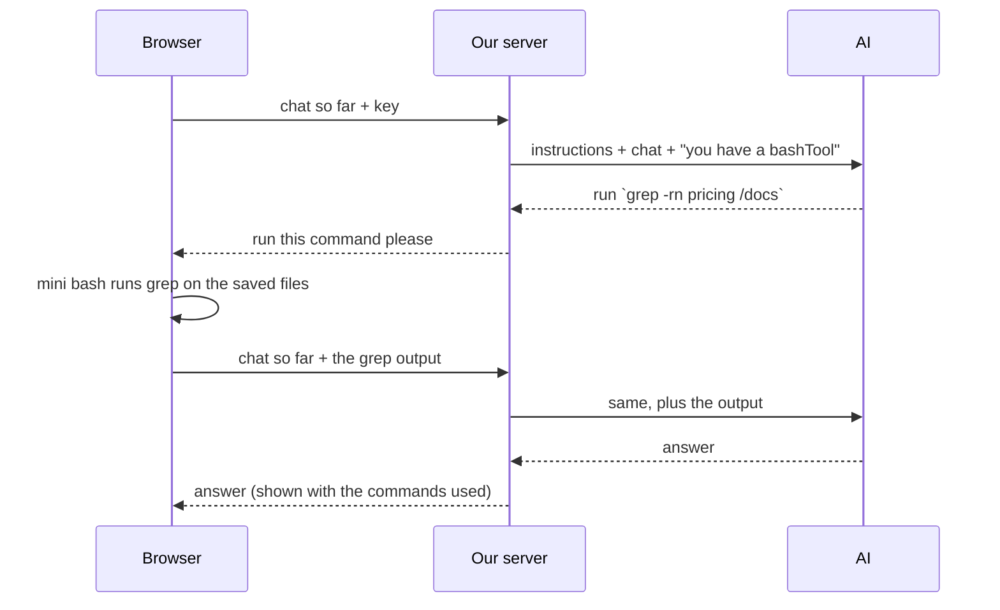

# How "Ask Your Docs" works

> Updated after every step. The plan is in `prd.md`; the reasons behind choices are in
> `docs/decisions.md`.
> Branch `mvp` · Course version saved as tag `course-complete`.

**Status:** ✅ done · 🔁 exists, will change · 🗑 will be removed · ⬜ not built yet

---

## 1. Today: the course app (still running)

- The whole back-and-forth (AI → command → AI) happens **on the server** in one request.
- What has to change:
  1. The server only reads the **last** message, so follow-up questions don't work.
  2. The agent and sandbox are created **once and shared** by everyone, with one fixed model.
  3. Commands run in a **sandbox on the server**, but the files will be in the browser.

---

## 2. Target: the MVP

### One question, step by step

Each command = one more request from the browser. So the browser must send the **whole chat**
every time, and the server keeps no memory between requests.

---

## 3. Parts

| Part | File | Status | Step |
|---|---|---|---|
| Chat page | `app/form.tsx` | 🔁 one question only, shows server commands | 7, 11 |
| Page layout | `app/page.tsx` | 🔁 chat only | 1 |
| Server route | `app/api/route.ts` | 🔁 reads only the last message | 5, 10 |
| Agent | `lib/agent.ts` | 🔁 created once, shared, uses sandbox | 8, 10 |
| bash tool | `lib/tools.ts` | 🔁 runs on the server | 6 |
| Sandbox | `@vercel/sandbox` | 🗑 | 8 |
| Course transcripts | `lib/calls/*.md` | 🔁 become sample files | 3, 8 |
| Files panel | `components/files-panel.tsx` | ⬜ | 1 |
| Saved files | `lib/files.ts` | ⬜ | 2 |
| Mini bash | `lib/shell.ts` (+ tests) | ⬜ | 4 |
| AI instructions | `lib/instructions.ts` | ⬜ | 6 |
| Settings box | `components/settings-dialog.tsx`, `lib/settings.ts` | ⬜ | 9 |
| Model picker | `lib/models.ts` | ⬜ | 10 |

---

## 4. Packages

| Package | Why |
|---|---|
| `ai` 6.0.315, `@ai-sdk/react` 3.0.318 | agent + chat. We stay on **v6**: add AI SDK packages with `@ai-v6`, not plain `pnpm add` |
| `@ai-sdk/google`, `@ai-sdk/openai`, `@ai-sdk/anthropic` | talk to the user's chosen provider (Step 10) |
| `just-bash` 3.6.0 | the mini bash in the browser (Step 4) |
| `vitest` | tests (Step 4) |
| `@vercel/sandbox`, `@ai-sdk/openai-compatible` | 🗑 removed in Step 8 |

Node: `>=22` in `package.json`. Vercel uses 24, your laptop runs 26.

---

## 5. Where it runs

| Branch | Vercel | URL |
|---|---|---|
| `mvp` | Preview | https://filesystem-agent-git-mvp-kodent-labs.vercel.app |
| `main` | Preview for now | Vercel's production branch is still `master`. Fix it in Step 12. |

---

## 6. Log

| Step | What happened |
|---|---|
| 0 | Tagged `course-complete`, made branch `mvp`, first preview deploy. |
| 0 | Read through the code; found the 3 things to change (§1). Wrote these docs. |
| 0 | Packages updated (one copy of `ai`, v6 providers, vitest, Node `>=22`). Refreshed the expired local OIDC token. |
| 0 | Spike 1: `just-bash` ran `grep -rn hello /docs`, pipes and globs in Chrome. It only downloads on first use, and a fresh copy per command throws away any writes. |
| 0 | Spike 2: a tool with no `execute`; the browser answered it (`onToolCall` → `addToolOutput`) and resent the chat (`sendAutomaticallyWhen`). 2 requests in total; the AI used the browser's answer. |
| 0 | Plan simplified: text files only, files saved in the browser, user's own key (Google / OpenAI / Anthropic). |
