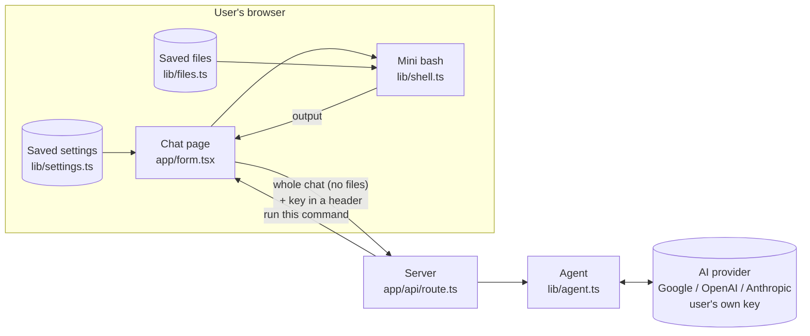
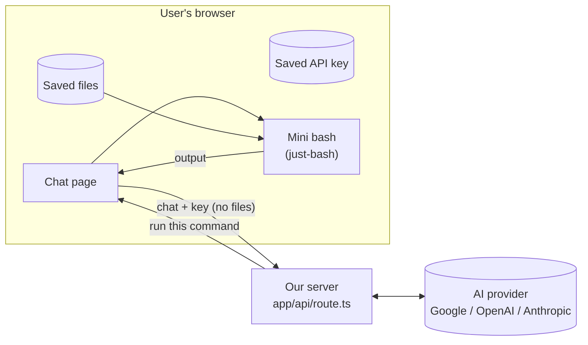
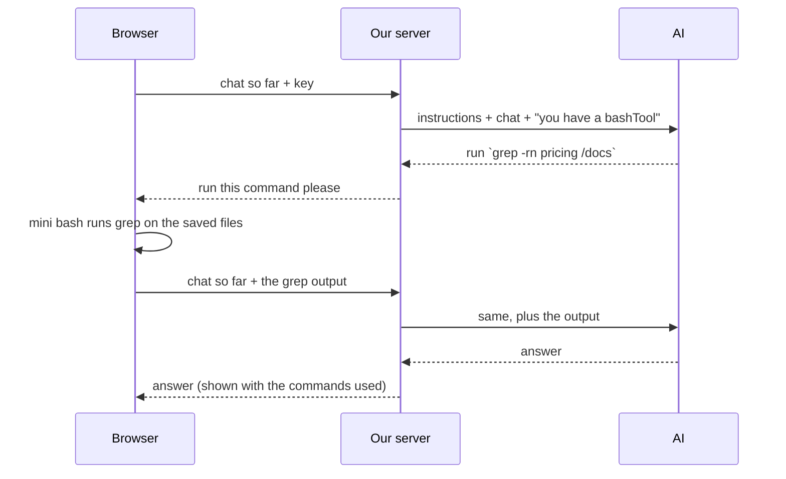

# How "Ask Your Docs" works

> Updated after every step. The plan is in `docs/prd.md`; the reasons behind choices are in
> `docs/decisions.md`.
> Branch `mvp` · Course version saved as tag `course-complete`.

**Status:** ✅ done · 🔁 exists, will change · 🗑 will be removed · ⬜ not built yet

---

## 1. Now (after Step 10)

- Commands run **in the browser** over the saved files. The server has no files and no sandbox.
- The server has **no key of its own**: every request carries the user's provider, key and model as headers, and a new agent is made for it.
- What had to change:
  1. ~~The server only reads the **last** message, so follow-up questions don't work.~~ Fixed in Step 5.
  2. ~~The agent is created **once and shared**, with **our** AI Gateway key and one fixed model.~~ Fixed in Steps 9–10.
  3. ~~Commands run in a **sandbox on the server**, but the files are in the browser.~~ Fixed in Steps 6–8.

---

## 2. Target: the MVP

### One question, step by step

Each command = one more request from the browser. So the browser must send the **whole chat**
every time, and the server keeps no memory between requests.

---

## 3. Parts

| Part | File | Status | Step |
|---|---|---|---|
| Chat page | `app/form.tsx` | ✅ runs the AI's commands in the browser: `onToolCall` → `runCommand(command, await listFiles())` → `addToolOutput`, resends with `sendAutomaticallyWhen`. Max 10 commands per answer (counter in a `useRef`). Shows `$ command` + output, tool errors in red, "Thinking…" while waiting, red notices (no answer, connection lost). Input pinned to the bottom; follows the newest message; "New chat" (keeps files and settings); with no key, opens Settings instead of sending | 5, 7, 9–11 |
| Page layout | `app/page.tsx` | ✅ files panel on the left, chat on the right | 1 |
| Server route | `app/api/route.ts` | ✅ reads `x-provider` / `x-api-key` / `x-model`; no key → 400 "Add your API key in Settings.", unknown provider → 400 "Choose a provider in Settings."; no fallback key. New agent per request, whole chat via `createAgentUIStreamResponse`. `onError` logs only the status code for provider errors | 5, 10 |
| Agent | `lib/agent.ts` | ✅ `createAgent(model)`: a new `ToolLoopAgent` per request with `INSTRUCTIONS` + `bashTool` | 8, 10 |
| bash tool | `lib/tools.ts` | ✅ `bashTool`: input `{ command: string }` (one full command line, D7), **no `execute`**, so the agent loop stops and the browser runs it | 6 |
| Sandbox | `@vercel/sandbox` | ✅ removed in Step 8 | 8 |
| Course transcripts | `lib/calls/*.md` | ✅ deleted in Step 8 (copies live in `public/samples/`) | 8 |
| Sample files | `public/samples/call-*.md` | ✅ copies of the 3 transcripts with clear names; "Load sample files" button in the panel | 3 |
| Files panel | `components/files-panel.tsx` | ✅ pick or drop files, list name + size, × remove, Clear all, red error messages. Loads saved files on open | 1, 2 |
| Saved files | `lib/files.ts` | ✅ `listFiles` / `addFile` / `removeFile` / `clearFiles` over IndexedDB (`idb-keyval`, database `ask-your-docs`, store `files`, key = file name). Rules: 4 types, 20 files, 1 MB, `notes (2).md` | 2 |
| Mini bash | `lib/shell.ts` (+ `lib/shell.test.ts`) | ✅ `runCommand(command, files) → { stdout, stderr, exitCode, truncated }`. Loads `just-bash` on first use, new `Bash` per command, `cwd /docs`, hardened limits, output cut at 8,000 characters, never throws. Called by the chat page | 4, 7 |
| AI instructions | `lib/instructions.ts` | ✅ general assistant; searches `/docs` only when the question depends on the files (D15); one `grep -rni` first, then `sed -n` for lines; file answers cite `[file:line]`; says when something isn't in the documents | 6, 11 |
| Settings box | `components/settings-dialog.tsx`, `lib/settings.ts` | ✅ button at the top of the left panel (shows provider · model, or "no API key yet" in red) opens a `<dialog>`: provider, hidden key field, model ID (default per provider), "Get a key" link. Saved in `localStorage` (`ask-your-docs-settings`). The chat's transport reads it on every request and sends 3 headers | 9 |
| Model picker | `lib/models.ts` | ✅ `getModel(provider, apiKey, modelId)`: `createGoogleGenerativeAI` / `createOpenAI` / `createAnthropic` with the user's key. `isProvider()` checks the header (`Object.hasOwn`, so `toString` is refused) | 10 |
| OpenRouter provider | `lib/settings.ts`, `lib/models.ts` | ✅ 4th provider: `createOpenRouter({ apiKey, compatibility: 'strict', appName })` `.chat(modelId)`; default `openai/gpt-5-mini`; key link openrouter.ai/keys; 402 → "out of credits" message | 12 |
| PDF text reader | `lib/pdf.ts` (planned) | ⬜ | 13 |

---

## 4. Packages

| Package | Why |
|---|---|
| `ai` 6.0.315, `@ai-sdk/react` 3.0.318 | agent + chat. We stay on **v6**: add AI SDK packages with `@ai-v6`, not plain `pnpm add` |
| `@ai-sdk/google`, `@ai-sdk/openai`, `@ai-sdk/anthropic` | talk to the user's chosen provider with their key (Step 10). Only imported by the server (`lib/models.ts`) |
| `@openrouter/ai-sdk-provider` **2.10.0** (pinned) | OpenRouter (Step 12). The 2.x line is for AI SDK v6; 3.x needs v7, so don't upgrade it on its own |
| `just-bash` 3.6.0 | the mini bash in the browser (Step 4) |
| `idb-keyval` 6.3.0 | saves files in the browser's IndexedDB (Step 2). Tiny, Apache-2.0; opens the database lazily, so it's safe on the server |
| `vitest` | tests: `pnpm test` runs `vitest run` (Step 4) |
| ~~`@vercel/sandbox`, `@ai-sdk/openai-compatible`~~ | removed in Step 8 |

Node: `>=22` in `package.json`. Vercel uses 24, your laptop runs 26.

---

## 5. Where it runs

| Branch | Vercel | URL |
|---|---|---|
| `mvp` | Preview | https://filesystem-agent-git-mvp-kodent-labs.vercel.app |
| `main` | Preview for now | Vercel's production branch is still `master`. Fix it in Step 14. |

---

## 6. Log

| Step | What happened |
|---|---|
| 0 | Tagged `course-complete`, made branch `mvp`, first preview deploy. |
| 0 | Read through the code; found the 3 things to change (§1). Wrote these docs. |
| 0 | Packages updated (one copy of `ai`, v6 providers, vitest, Node `>=22`). Refreshed the expired local OIDC token. |
| 0 | Spike 1: `just-bash` ran `grep -rn hello /docs`, pipes and globs in Chrome. It only downloads on first use, and a fresh copy per command throws away any writes. |
| 0 | Spike 2: a tool with no `execute`; the browser answered it (`onToolCall` → `addToolOutput`) and resent the chat (`sendAutomaticallyWhen`). 2 requests in total; the AI used the browser's answer. |
| 0 | Plan simplified: text files only, files saved in the browser, user's own key (Google / OpenAI / Anthropic). |
| 1 | Files panel added beside the chat. Picking or dropping files reads their text (`file.text()`) into React state as `{ name, size, text }`. Not saved yet, and not connected to the chat. |
| 2 | Files saved in IndexedDB through `lib/files.ts`; the panel re-reads the saved list after every change. Tested in Chrome: survives reload, duplicate → `notes (2).md`, `.pdf` and >1 MB refused, 21st file refused, remove and clear stick after reload. |
| 3 | Transcripts copied to `public/samples/` as `call-1-platform-review.md`, `call-2-follow-up-review.md`, `call-3-commercial-alignment.md`. The button fetches the missing ones, wraps them as `File`s and adds them like a user pick. It hides once all 3 are saved, so no copies. |
| 4 | `lib/shell.ts` added, with 9 vitest tests (`pnpm test`): grep with line numbers, `-i`, pipes, names with spaces, exit codes 0/1/127, no network (`curl` doesn't exist), writes thrown away, 8,000-character cut, no files. |
| 5 | The route sends the whole chat to the agent (`createAgentUIStreamResponse`); the input stays visible. Tested in Chrome: the 2nd request carried `user,assistant,user`, and "how many calls did we have with **them**" was answered as Northstar Commerce (3 calls). Old tool still sends bad commands (D7, 400s from the sandbox) until Step 6. Refreshed the local OIDC token. |
| 5 | Fix: "hi" ran 19 commands and read every file, because the course instructions said to always use `bashTool`. The instructions in `lib/agent.ts` now say: use the tool only when the message needs the files, reply to small talk without tools, and start with one targeted search. Retested: "hi" and "thanks!" use 0 commands. |
| 6–7 | The switch. `bashTool` has no `execute`; the browser runs it over the saved files with `just-bash` and sends the output back. Tested in Chrome with the samples: "hi" → 1 request, 0 commands; "Did anyone mention pricing?" → 2 commands (one `grep -rni -e … /docs`), answer with `[file:line]`; finance follow-up → 1 command; "CEO's favourite colour" → "Not found in your documents."; limit test → 10 commands ran, 11th and 12th refused, stopped. Biggest request 9,800 characters; no request contained a whole file. |
| 8 | Sandbox removed: `lib/agent.ts` is just the agent (no `Sandbox.create()`, no `fs`/`path`), `lib/calls/` deleted, `@vercel/sandbox` and `@ai-sdk/openai-compatible` uninstalled (not in the lockfile either). `pnpm build` passes. Tested in Chrome: "hi" → 0 commands; pricing → 2 commands with citations. First request 1.3 s (was ~18 s while the sandbox VM started). |
| 9–10 | Bring your own key. Settings box saves provider + key + model in the browser; the chat sends them as `x-provider` / `x-api-key` / `x-model`; the server makes a new agent with that key for each request. Defaults: `gemini-3.8-flash`, `gpt-6-luna`, `claude-haiku-5-5` (D14). `AI_GATEWAY_API_KEY` commented out in `.env.local`. Tested in Chrome: no key → "Add your API key in Settings." (no key header sent); dialog saves and survives reload; switching provider switches model + key link; a fake Google key went only in the header (not in the body), Google answered "API key not valid", server logged `Provider error: google 400`, and the key is nowhere in the server log. Known: the AI SDK's own default logger also prints provider errors; today it shows the request body only as `[Object]`. Not yet tested with a real key. |
| 9–10 | Fix: with a real key, "hi" showed nothing. Cause: `gemini-3.8-flash` (and 3.7) were overloaded at Google (503 "high demand" after 16 s, or no answer at all), the SDK retried, and the page showed nothing while waiting. Changes: Google default → `gemini-3.5-flash-lite` (answered in 6–8 s with 1–2 commands); 60 s `timeout` on each request; "Thinking…" while waiting; plain messages for 401/403/`API_KEY_INVALID` (wrong key), 404 (model), 429 (rate limit), 500/503 (busy); a red "No answer came back…" when the stream ends without a finish reason (that's how the timeout arrives: an `abort`, not an error). |
| 11 | Chat polish. Input bar pinned to the bottom (`sticky bottom-0`); the window scrolls to the newest message on every update; "New chat" clears messages (`stop` + `setMessages([])`), keeps files and settings; empty-chat hint; Send without a key opens Settings through a small browser event (`openSettings()` in `lib/settings.ts`) and sends nothing. Tested in Chrome (600 px tall window): no key → Settings opened, 0 requests, question kept; after 2 long answers the page was at the bottom, input visible, last message above it; New chat → 0 messages, 3 files kept; offline → "Lost the connection to the server…". |
| 11 | General assistant (D15): the instructions said "answer only from the files", so "how hot is the sun?" got "not mentioned in the documents". Now it answers general questions itself and searches the files only when the question is about them. Tested: sun, "is your knowledge limited to documents?", "what does ISR mean?" → 0 commands, normal answers; pricing / "who is Claire Donovan?" → grep + citations; "do my files mention the CEO's favourite colour?" → "not in your documents". |
| — | `prd.md` moved to `docs/prd.md` and tracked in git (it was ignored), so the plan and the reasons behind it ship with the code. |
| — | Plan: new Phase 6 (D16): Step 12 OpenRouter, Step 13 PDF. Shipping moves to Phase 7 / Step 14. |
| 12 | OpenRouter added as a 4th provider. Checked on OpenRouter's public model list: `openai/gpt-5-mini` (default, tools, $0.25/$2 per M tokens), `deepseek/deepseek-v4-flash` ($0.09/$0.18), `google/gemma-4-31b-it:free` (free, 20/min and 50/day). Tested: Settings lists OpenRouter with its default model and key link; a fake key → OpenRouter 401 → "Your API key was rejected."; the key is not in the server log. Not yet tested with a real OpenRouter key. |
