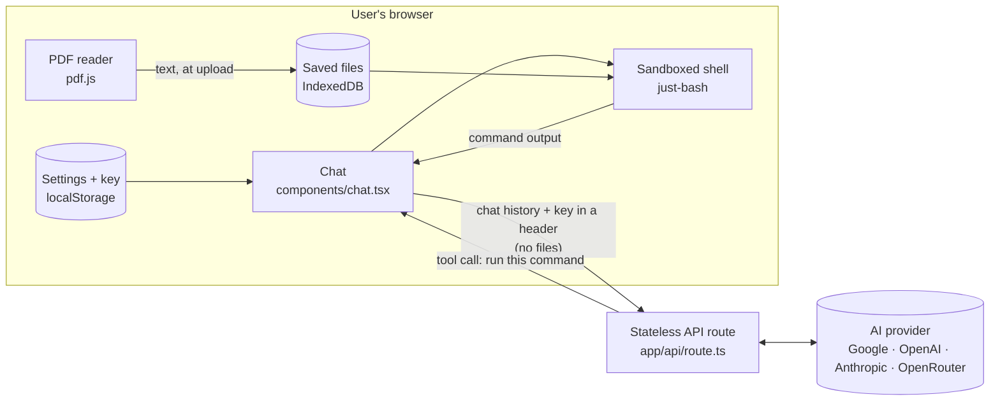
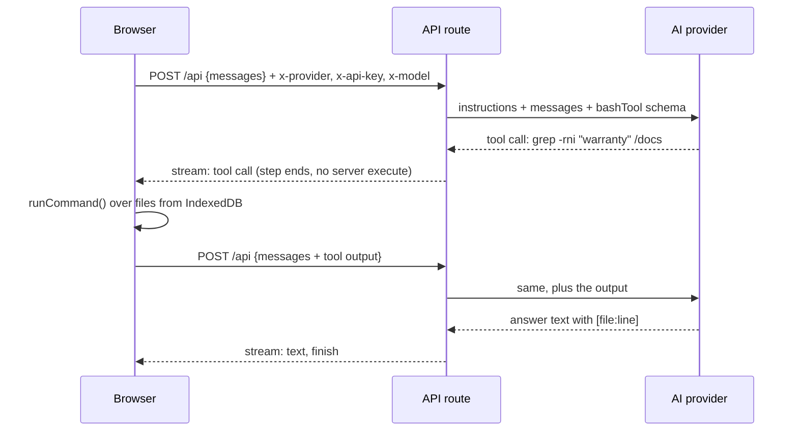

# Ask Your Docs: Architecture

> How the system is built. **Why** it is built this way is in [decisions.md](decisions.md);
> **what** it does is in [prd.md](prd.md).

## 1. Overview

Ask Your Docs is an AI agent whose **reasoning runs on the server and whose tool runs in the
browser**. The model decides which shell command to run; the browser runs it over files that only
exist on the user's device, and sends back just the output.



**Key properties**

- **No server state.** No database, no file storage, no sessions. Every request carries everything
  it needs.
- **No server secrets.** The server holds no AI key; each request uses the caller's key.
- **Files never uploaded.** The server only sees the chat, including the output of commands the
  model asked for (capped at 8,000 characters each).

## 2. Components

| Layer | File | Responsibility |
|---|---|---|
| Page | `app/layout.tsx`, `app/page.tsx` | HTML shell; two-column layout (files + settings, chat) |
| Chat | `components/chat.tsx` | `useChat` setup, runs tool calls, loop limit, errors and notices, input |
| Message view | `components/chat-message.tsx` | Renders text and command parts (`$ command` + output) |
| Files panel | `components/files-panel.tsx` | Pick or drop files, list, remove, clear, errors |
| Settings | `components/settings-dialog.tsx` | Provider, key and model form in a native `<dialog>` |
| File store | `lib/files.ts` | `addFile` / `listFiles` / `removeFile` / `clearFiles`; type and size rules |
| PDF reader | `lib/pdf.ts` | `pdfToText(file)`: text per page with `--- page N ---` markers |
| Shell | `lib/shell.ts` | `runCommand(command, files)` → `{ stdout, stderr, exitCode, truncated }` |
| Settings store | `lib/settings.ts` | Provider list and defaults, `localStorage` read/write, "open settings" event |
| API route | `app/api/route.ts` | Validates headers, builds the model, streams the agent, maps errors |
| Model factory | `lib/models.ts` | `getModel(provider, apiKey, modelId)` for the four providers |
| Agent | `lib/agent.ts` | `createAgent(model)`: a `ToolLoopAgent` with instructions and the tool |
| Tool | `lib/tools.ts` | `bashTool`: input `{ command: string }`, no `execute` (runs client-side) |
| Instructions | `lib/instructions.ts` | System prompt: when to search, how to search, how to cite |

The browser side imports nothing from the server side and vice versa, except shared constants and
types from `lib/settings.ts`. Provider SDKs are only bundled into the server.

## 3. One question, end to end



- The AI SDK's `useChat` sends the next request automatically once every tool call in the last
  message has an output (`sendAutomaticallyWhen: lastAssistantMessageIsCompleteWithToolCalls`).
- Each command is one extra round trip, so the instructions push for one broad search first.
- The server converts the UI messages and streams with `createAgentUIStreamResponse`; a new agent
  and model client are created per request.

## 4. Data

**Saved file** (IndexedDB database `ask-your-docs`, store `files`, key = file name)

```ts
type DocFile = { name: string; path: string; text: string; size: number; addedAt: number };
// path is "/docs/<name>"; for a PDF, text is the extracted text with page markers
```

**Settings** (`localStorage`, key `ask-your-docs-settings`)

```ts
type Settings = { provider: 'google' | 'openai' | 'anthropic' | 'openrouter'; apiKey: string; modelId: string };
```

**Request** `POST /api`: body `{ id, messages }` (AI SDK UI messages); headers `x-provider`,
`x-api-key`, `x-model`. **Response:** a UI message stream (server-sent events).

**Tool** `bashTool`: input `{ command }` → output `{ stdout, stderr, exitCode, truncated }`.

## 5. The agent loop

| Concern | How it's handled |
|---|---|
| Who decides | The model, guided by `lib/instructions.ts`: search only when the question depends on the files |
| Tool input | One full command line (pipes allowed), e.g. `grep -rni -e "price" -e "cost" /docs` |
| Where it runs | `onToolCall` in `components/chat.tsx` → `runCommand` → `addToolOutput` (not awaited, per the SDK) |
| Isolation | A fresh `just-bash` instance per command with the `hardened` limit profile, `cwd /docs`, files mounted from IndexedDB; no network; writes are discarded |
| Loop limit | 10 commands per answer. The 11th gets an error output telling the model to answer with what it has; after one more round, nothing more is sent |
| Output size | stdout and stderr cut to 8,000 characters each, with `truncated: true` |
| Server step limit | The SDK's default (20 steps) never triggers, because each request ends at the first tool call |

## 6. Security and privacy

| Data | Where it lives | Who sees it |
|---|---|---|
| Whole files | IndexedDB in the user's browser | Only the user's browser |
| Command output (file excerpts) | In the chat history | Our API route (in memory, per request) and the user's AI provider |
| API key | `localStorage` | Sent per request in `x-api-key` to our route, which passes it to the provider SDK. Never stored or logged |
| Chat history | Browser memory (cleared by reload or New chat) | Our API route (per request) and the AI provider |

- **Logging:** provider failures are logged as provider name and HTTP status only. One provider
  echoes part of a wrong key in its error message, so messages are not logged. Other errors log
  `error.message`, never the full error object (it can contain the request body).
- **Command safety:** the model's commands can't reach the network, the server or the real disk;
  the shell is an interpreter over an in-memory file system.
- **Input validation:** the route rejects a missing key or an unknown provider with HTTP 400
  before parsing the body; the provider name is checked with `Object.hasOwn`.
- **Known gap:** the AI SDK's own default error logger also prints provider errors. It shows the
  request body only as `[Object]`, but it isn't under our control.

## 7. Failure handling

| Failure | Detected by | User sees |
|---|---|---|
| No key | Chat, before sending | Settings opens; the question stays typed |
| Wrong key | 401/403, or Google's `API_KEY_INVALID` | "Your API key was rejected. Check it in Settings." |
| Unknown model | 404 | "Model not found. Check the model name in Settings." |
| Out of credits | 402 | "Your provider account is out of credits…" |
| Rate limited | 429 | "Too many requests for your key. Wait a minute…" |
| Provider overloaded | 500/503 (after the SDK's retries) | "The model is busy right now…" |
| Provider hangs | 60-second request timeout → stream ends without a finish reason | "No answer came back: the model may be busy or took too long…" |
| Network down | `useChat` reports a disconnect | "Lost the connection to the server…" |
| Bad command | Non-zero exit code / stderr in the tool output | Shown under the command; the model can retry |
| File rules | `lib/files.ts` / `lib/pdf.ts` throw a message | Red line in the files panel (wrong type, too big, 20 files, scanned or locked PDF) |

## 8. Performance

- **Lazy loading:** `just-bash` (~400 KB) loads on the first command; `pdf.js` (~130 KB gzipped,
  plus a ~375 KB worker) loads on the first PDF. Neither is in the initial page load.
- **Round trips:** a typical answer needs 1–3 commands (2–4 requests). The browser sends the full
  history each time; the output cap keeps requests small.
- **Cold start:** the API route has no setup work (no sandbox, no index), so the first request is
  as fast as any other.

## 9. Deployment

- **Vercel**, Next.js 16 App Router with Turbopack, Node.js runtime. The API route is the only
  serverless function; the page is static.
- **No environment variables are required:** the server has no keys and no storage.
- `next build --webpack` is not supported (`just-bash` uses `node:` imports that only Turbopack
  handles); the default Turbopack build is used.

## 10. Testing

- `pnpm test` runs Vitest unit tests for the shell (`lib/shell.test.ts`): grep with line numbers,
  pipes, names with spaces, exit codes, no network, discarded writes, output cap, empty folder.
- `pnpm exec tsc --noEmit` type-checks the project.
- End-to-end behaviour is checked against the acceptance checklist in [prd.md](prd.md) §9.

## 11. Extending

- **New provider:** add an entry to `PROVIDERS` in `lib/settings.ts` and a `case` in
  `lib/models.ts`. The Settings dialog picks it up automatically.
- **New file type:** add the extension to `TYPES` in `lib/files.ts` and convert it to text in
  `addFile` (as `lib/pdf.ts` does for PDFs). The shell, the tool and citations need no changes.
- **New tool:** define it in `lib/tools.ts` without `execute`, add it to the agent, and handle its
  name in `onToolCall`.

## 12. Packages

| Package | Role |
|---|---|
| `next` 16, `react` 19 | App framework |
| `ai` 6, `@ai-sdk/react` 3 | Agent loop, streaming, chat state |
| `@ai-sdk/google`, `@ai-sdk/openai`, `@ai-sdk/anthropic` | Provider clients (server only) |
| `@openrouter/ai-sdk-provider` 2.10.0 | OpenRouter client; the 2.x line targets AI SDK 6 |
| `just-bash` 3.6 | Sandboxed shell interpreter in the browser |
| `pdfjs-dist` 6.4 (legacy build) | PDF text extraction in the browser |
| `idb-keyval` 6.3 | Tiny promise wrapper over IndexedDB |
| `zod` 4 | Tool input schema |
| `vitest` 5, `tailwindcss` 4, `typescript` 5 | Tests, styles, types |
