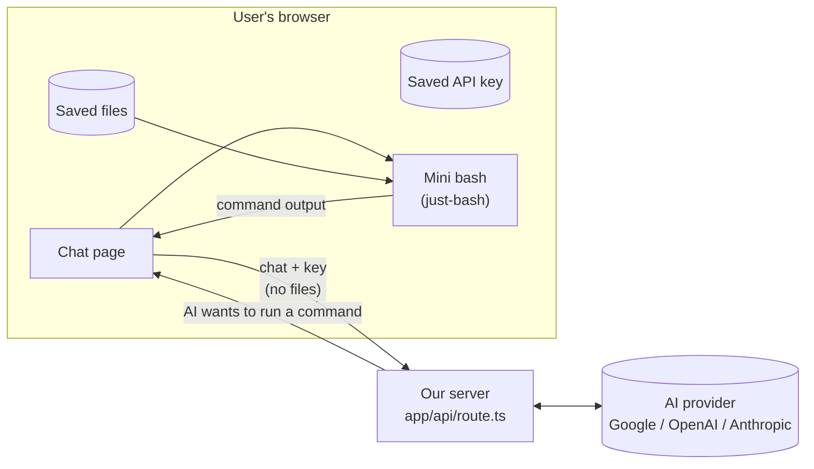

# Plan — "Ask Your Docs" (simple MVP)

> Owner: Khush Panchal · Rewritten: 2026-10-24 (simplified) · Branch: `mvp`
> We grow this repo (the finished Vercel "Filesystem Agents" course app) step by step.
> The app must still work after every step.

---

## 1. What we're building

A web page where someone:

1. adds a few text files,
2. types a question,
3. gets an answer: from those files when the question is about them (and can see which commands
   the AI ran to find it), or from the AI's general knowledge otherwise (D15).

The files stay in **their own browser** (they're still there after a reload, and they're never
uploaded anywhere). They use **their own AI API key**. That's the whole MVP: it's for us to try it out.

---

## 2. How we work (Claude, read this first)

- **From Step 2 on, Claude writes the code**; the user reviews the diff in the IDE to understand it
  (the user does not write code).
- For each step: commit the previous step (when the user says it's tested) → Claude builds the
  next step and leaves it **uncommitted** → runs `pnpm exec tsc --noEmit` and runs the app →
  explains in plain words what was done (compare to the user's Python agent or Kotlin), how to
  run it and what to expect.
- After each step, update `docs/hld.md` (what's built now) and, if a choice was made,
  `docs/decisions.md`.
- Commit / push only when the user asks. Message style: `feat(<area>): <step> <title>`.
- Use a subagent for web/doc research to keep the chat short.
- Check library APIs against the installed package (`node_modules/<pkg>`) before teaching them.
- **Keep it simple.** If something isn't needed for "add files → ask → answer", it goes to §7.

---

## 3. What's in and what's out

| In the MVP | Not in the MVP (see §7) |
|---|---|
| Add text files (`.txt .md .csv .json`) and **PDF** (text read in the browser, D16) | Word, scanned PDFs (no text to read) |
| Files saved in the browser, list / remove / clear | Accounts, database, sync between devices |
| Ask questions, follow-up questions | Clickable citations, saving the chat |
| See every command the AI ran + its output | Very long chats (auto-trimming history) |
| User's own key: Google, OpenAI, Anthropic or **OpenRouter** (D16) | AI Gateway, Ollama |
| "Load sample files" button (the 3 course transcripts) | Rate limiting, polish, accessibility work |

---

## 4. How it works

In words:
1. The user asks a question. The browser sends the **chat so far** and the **API key** to our
   server. It does **not** send the files.
2. The server asks the AI. The AI replies "run `grep -rn pricing /docs`".
3. The server can't run that, because the files are in the browser. So it passes the command
   back to the browser.
4. The browser runs it with a small bash that lives in the page (`just-bash`), over the saved files.
5. The browser sends the output back. The AI reads it and answers, or asks for another command.

Every command is one extra trip from browser → server → AI. That's why we keep the AI's
instructions short and tell it to use one good `grep` instead of many `cat`s.

### Shapes of the data
- **Request** `POST /api`: body `{ messages }` (the whole chat). Headers `x-provider`,
  `x-api-key`, `x-model`.
- **Tool** `bashTool`: input `{ command: "grep -rn pricing /docs" }` → output
  `{ stdout, stderr, exitCode, truncated }`.
- **Saved file**: `{ name, path: "/docs/<name>", text, size, addedAt }`.
- **Saved settings**: `{ provider, apiKey, modelId }`.

---

## 5. Steps

### ✅ Step 0 — Get ready (done)
- Tagged the course version `course-complete`; working on branch `mvp`.
- Walked through the current code; wrote `docs/hld.md` and `docs/decisions.md`.
- Installed packages (AI SDK v6 line, `just-bash`, `vitest`).
- Spike 1: `just-bash` runs `grep` over in-memory files in the browser.
- Spike 2: the AI can ask for a tool, the browser runs it, and the AI answers.

### Phase 1 — Files in the browser (the old chat keeps working)

**✅ Step 1 · Files panel**
- New `components/files-panel.tsx`, shown next to the chat in `app/page.tsx`.
- Pick or drag-and-drop text files. Show name and size.
- Done when: chosen files are listed on screen.

**✅ Step 2 · Save files in the browser**
- New `lib/files.ts` with `addFile`, `listFiles`, `removeFile`, `clearFiles` (using `idb-keyval`).
- Rules: only `.txt .md .csv .json`, max 20 files, max 1 MB each, same name → add a number.
- Done when: files are still listed after a reload; remove and clear work.

**✅ Step 3 · Sample files button**
- Copy `lib/calls/*.md` into `public/samples/`; a button loads them into the files panel.
- Done when: one click adds the 3 transcripts.

### Phase 2 — Bash in the browser

**✅ Step 4 · `runCommand`**
- New `lib/shell.ts`: `runCommand(command, files) → { stdout, stderr, exitCode, truncated }`.
  - Load `just-bash` only when first needed (`await import`).
  - A new `Bash` for every command, so nothing a command writes is kept.
  - Cut output at ~8 KB and set `truncated: true` (all output is sent to the AI every time).
- Tests in `lib/shell.test.ts` with `vitest`; add a `"test"` script.
- Done when: `pnpm test` passes.

### Phase 3 — Switch from the sandbox to the browser

**✅ Step 5 · Server receives the whole chat**
- `app/api/route.ts`: stop taking only the last message; use
  `createAgentUIStreamResponse({ agent, uiMessages: messages })` (proven in Spike 2).
- Done when: a follow-up question works (temporarily show the input after the first answer).

**✅ Step 6 · Tool without `execute` + new instructions**
- `lib/tools.ts`: `bashTool` with input `{ command: string }` and **no** `execute`.
- New `lib/instructions.ts`: files are in `/docs`; prefer one `grep -rn`; answer only from the
  files; say "not found in your documents"; mention `[file:line]`.
  *Changed by D15:* it's a general assistant that searches the files only when the question
  depends on them.

**✅ Step 7 · Browser runs the tool**
- `app/form.tsx`: `onToolCall` → `runCommand(command, files)` → `addToolOutput`;
  `sendAutomaticallyWhen: lastAssistantMessageIsCompleteWithToolCalls`.
- Stop after 10 commands in one answer.
- Show `$ command` and its output.
- Done when: with the samples loaded, "did anyone mention pricing?" gets answered.

**✅ Step 8 · Remove the sandbox**
- `lib/agent.ts`: delete the `Sandbox` and file-copy code. `pnpm remove @vercel/sandbox
  @ai-sdk/openai-compatible`. Delete `lib/calls/`.
- Done when: the app works with no sandbox and the type-check passes.

### Phase 4 — User's own key

**✅ Step 9 · Settings box**
- New `components/settings-dialog.tsx` + `lib/settings.ts` (localStorage): provider
  (Google / OpenAI / Anthropic), API key (hidden field), model ID (filled in per provider; check
  current IDs at this step). Link to "get a key" for each; suggest Google AI Studio (free, no card).
- The chat sends `x-provider`, `x-api-key` and `x-model` headers.

**✅ Step 10 · Server uses the user's key**
- New `lib/models.ts`: `getModel(provider, apiKey, modelId)`. One function, three providers,
  like `BaseProvider` in the Python agent.
- `lib/agent.ts`: `createAgent(model)` makes a new agent for every request (no shared global).
- Route: missing key or unknown provider → HTTP 400. Never log keys. No fallback server key.
- Done when: it works with a Google AI Studio key and `AI_GATEWAY_API_KEY` is gone from `.env.local`.

### Phase 5 — Make the chat usable

**✅ Step 11 · Chat polish**
- Input always visible, "New chat" button (keeps files), scroll to newest message.
- Plain-language errors: no key → open settings, wrong key, too many requests, network down.

### Phase 6 — More providers and files (added 2026-10-25, D16)

**Step 12 · OpenRouter**
- A 4th provider in Settings: one OpenRouter key gives access to many models.
- `lib/settings.ts`: add it to `PROVIDERS` (label, default model, key link).
  `lib/models.ts`: one more `case` (package/approach checked against the installed AI SDK v6).
- Done when: with an OpenRouter key, the sample questions are answered with commands + citations.

**Step 13 · PDF files**
- Accept `.pdf`: read its text **in the browser** when it's added (lazy-loaded PDF library),
  save it like a text file, with `--- page N ---` markers so citations can point to pages.
- Clear message for PDFs with no text (scanned) or with a password.
- Done when: a PDF's contents can be asked about, and it survives a reload.

### Phase 7 — Ship

**Step 14 · README + release**
- Short README: what it is, how to use it, "your files never leave your browser", credit to the
  Vercel course.
- Set Vercel's production branch to `main` (it's still `master`), merge `mvp` → `main`, deploy,
  run §6.

---

## 6. Test checklist (before shipping)
1. New browser → add an API key → add the samples + one file of your own.
2. Reload → files are still there.
3. Ask 3 questions → correct answers, commands are visible, answers mention the file.
4. Ask a follow-up that depends on the last answer → works.
5. Ask about something that isn't in the files → says it's not in your documents.
   Ask a general question ("how hot is the sun?") → answered normally, with no commands.
6. DevTools → Network: no request contains a whole file; the key is only in a header.
7. Wrong key → a clear message, not a crash.
8. `@vercel/sandbox` is gone from `package.json`.

---

## 7. Later (not in the MVP)
Word files · scanned PDFs (OCR) · clickable citations · saving the chat · trimming very long chats ·
AI Gateway / Ollama · smart search (RAG) · rate limiting · running the whole agent
in the browser (no server at all).

---

## 8. Things that bit us before
- **Local OIDC token expires (~12 h).** `pnpm dev` fails with "Could not get credentials from
  OIDC context" until Step 8 removes the sandbox. Refresh only the `VERCEL_OIDC_TOKEN` line
  (`vercel env pull` to a temp file); a plain `vercel env pull` overwrites `.env.local`.
- **AI SDK version:** plain `pnpm add @ai-sdk/x` installs v7 packages. We're on v6, so use
  `@ai-sdk/x@ai-v6`.
- **Never build with `--webpack`:** `just-bash` breaks it (`node:zlib`). Turbopack (default) is fine.
- **Stale Next types:** after deleting a page, `tsc` may complain about `.next/dev/types`;
  delete that folder.
- **Don't `await` `addToolOutput` inside `onToolCall`** (AI SDK docs: it can hang).
- **Unknown model → 4096 output tokens max:** set `maxOutputTokens` yourself.
- If the agent goes in circles, look at the **tool outputs** first.
- Check the file is saved on disk before debugging it.
